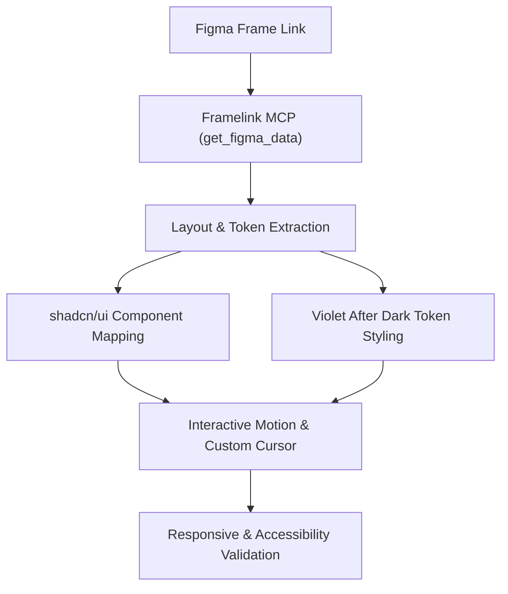

# Figma to Code Workflow Guide (Framelink Figma MCP)

This document describes the workflow for translating Figma design files and frame links directly into React + Tailwind CSS components for Radhika Kandalkar's portfolio using the Framelink Figma Model Context Protocol (`figma-developer-mcp`).

---

## 1. Architecture & Tooling

The **Framelink Figma MCP** (`figma-developer-mcp`, based on [GLips/Figma-Context-MCP](https://github.com/GLips/Figma-Context-MCP)) bridges Figma design files directly with AI coding assistants.

Unlike raw, heavily nested Figma REST API payloads, Framelink:
* Simplifies nested element trees into streamlined, CSS-aligned layout properties.
* Extracts auto-layout configurations, flex direction, gap, padding, corner radii, and color fills.
* Provides asset extraction (`download_figma_images`) for SVGs and high-resolution raster images.

---

## 2. Anatomy of a Figma URL

When referencing a specific component or frame in Figma, the URL typically follows this structure:

```text
https://www.figma.com/design/:fileKey/:fileName?node-id=:nodeId
```

* **`fileKey`**: The unique alphanumeric identifier representing the Figma design document (e.g., `aBcDeFg12345`).
* **`nodeId`**: The specific frame, component, or canvas node identifier (e.g., `124:89` or `0-1`).

---

## 3. End-to-End Conversion Pipeline



### Step 1: Query the Design Data
The assistant queries the Framelink MCP server using the extracted `fileKey` and `nodeId`:
```json
{
  "fileKey": "FILE_KEY",
  "nodeId": "NODE_ID"
}
```
The server returns the clean layout metadata: dimensions, auto-layout direction (`HORIZONTAL` / `VERTICAL`), spacing tokens (`itemSpacing`, `paddingLeft`, etc.), fills, and typography styles.

### Step 2: Asset & Icon Handling
* **Icons:** Match Figma icon layers against existing [`lucide-react`](file:///home/radhika/Desktop/my_portfolio/package.json) components to prevent bundle bloat and ensure crisp vector rendering.
* **Custom Graphics/Avatars:** Download via `download_figma_images` or map to existing optimized WebP assets in [`public/`](file:///home/radhika/Desktop/my_portfolio/public/).

### Step 3: Mapping to shadcn/ui Primitives
Wherever the Figma design contains common UI patterns, map them to our configured shadcn/ui components:
* **Cards & Containers:** `Card`, `CardHeader`, `CardContent`, `CardFooter`
* **Chips & Category Tags:** `Badge`
* **Call-to-Action Buttons:** `Button` (with `asChild` for external/internal anchor links)
* **Form Controls:** `Input`, `Textarea`
* **Modals & Overlays:** `Dialog`, `DialogContent`, `DialogHeader`
* **Interactive Tooltips:** `Tooltip`, `TooltipTrigger`, `TooltipContent`

### Step 4: Strict Violet After Dark Theming
All Figma color fills and borders must be adapted to match the signature **Violet After Dark** palette:
* **Midnight Backgrounds:** `--bg-primary` (`#07040d`), `--bg-secondary` (`#0d0718`), `--bg-tertiary` (`#130b24`), `--bg-surface` (`#180d2f`)
* **Primary Accents:** `--color-violet` (`#8b5cf6`), `--color-violet-light` (`#a78bfa`), `--color-violet-dark` (`#6d28d9`)
* **Lavender Accents:** `--color-lavender` (`#c4b5fd`), `--color-lavender-soft` (`#ede9fe`)
* **Glass Borders:** `--border-subtle` (`rgba(139, 92, 246, 0.16)`), `--border-glow` (`rgba(167, 139, 250, 0.55)`)
* **Typography:** Space Grotesk for headings/display, JetBrains Mono for code/stats/metrics.

### Step 5: Micro-Interactions & Custom Cursor Support
* Ensure interactive elements contain appropriate `data-cursor` tags (`data-cursor="View"`, `data-cursor="Open"`).
* Apply consistent spring easing (`cubic-bezier(0.16, 1, 0.3, 1)` or `transition={{ type: 'spring', stiffness: 380, damping: 30 }}`).
* Wrap motion variants in `useReducedMotion()` checks to guarantee full accessibility for users with motion sensitivity.

### Step 6: Responsive & Keyboard Testing
* Implement mobile-first layouts (`col-span-1 md:col-span-2`, stacked flex layouts collapsing cleanly on mobile viewports).
* Maintain visible high-contrast focus rings (`outline-ring/50`) and full keyboard navigation.
